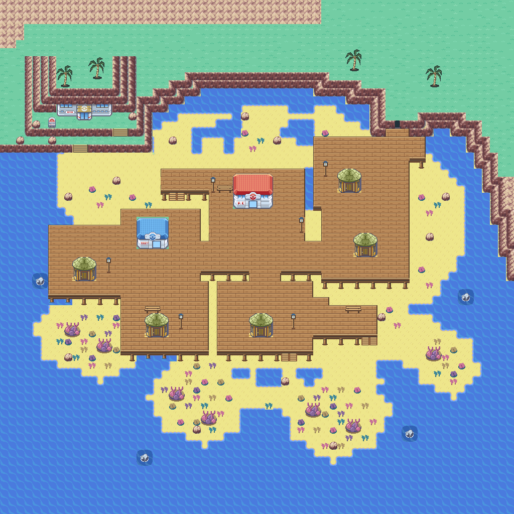
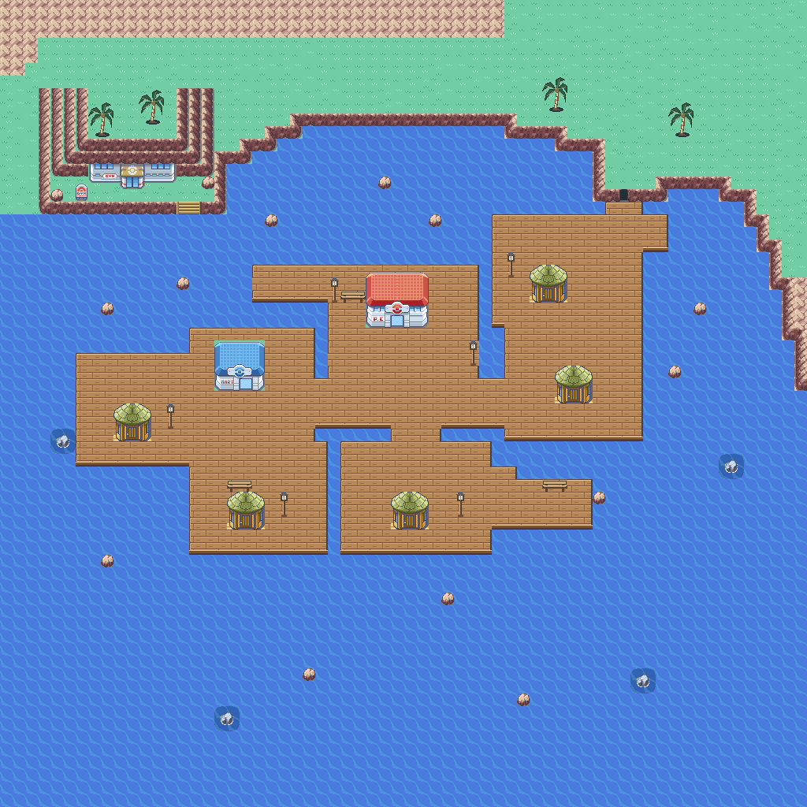

# Corvala cove: sand, residents and hourly tides

This pass starts from the user's Porymap cleanup in commit `0c02a4ba`.
The wooden town layout, five houses, Center, Mart and new gym frontage are
preserved. The gym warp now matches its visible door at (10,14); the entrance
cave warp matches (49,15). Event elevations match the edited dock levels.

## Low and high tide

Quantum uses the RTC (`OW_USE_FAKE_RTC = FALSE`). Corvala uses the same local
clock as the rest of the game: even hours are LOW and odd hours are HIGH.
An emulator must supply RTC support for real-time changes. The town checks
once per second during normal overworld play, after movement/dialogue/fades
finish. Time spent indoors or with the game closed is reflected on return.

High tide now covers **all sand**, the entire lowest northwest cliff terrace,
every dock support and the wooden stairs off the docks. No sand islands remain.
The lower sea-facing north/east cliff layer is fully submerged. Its entire
tiles become Surf water; the upper cliff caps and backing remain visible and
solid. Higher gym terraces remain above water, and the cave doorway retains
its frame. The outer map boundary remains blocked.
The five homes, Center, Mart and entrance cave stay connected by raised docks.
The walking route to the gym is available only at LOW tide, when its lower
terrace and beach are exposed again.

Native boulders stand on sand at LOW and have water beneath them at HIGH.
Four native sea-rock formations also appear in permanently wet areas in both
phases. Rocks are solid obstacles, with paths left clear around them.

Six existing dock-edge tiles above the submerged stairs are Surf landings at
HIGH. Their artwork stays unchanged; local map elevations provide the native
Surf launch/landing behavior without altering Surf rules elsewhere.

A tide change waits while the player is exploring the sandbar, gym terraces, or surfing.
It applies on reaching permanent shore or the docks and stopping. This avoids
flooding a walking player, stranding an island visitor, or drying the water
beneath a surfer. A restored save view preserves the prior phase until safe.
No new save fields are used. Map differences and safe positions live in ROM;
the existing virtual map buffer is reused, with only two added EWRAM bytes.

This first tide pass affects the town exterior. The tidal gym interior still
has its pools and attendant; its leader battle, badge and tide puzzles remain
unfinished. There is no middle tide or tide animation in this pass.

## Encounters and residents

Bare Corvala sand uses a local metatile encounter attribute while retaining
sand behavior and footprints. Primary/shared sand tiles are unchanged. Docks
have no land encounters. There are twelve sand slots plus Surf and fishing
tables, using the existing encounter/randomizer pipeline. Current provisional
levels are 18–22; tune these alongside Corvala's campaign placement.

Six residents occupy the docks, with dialogue about tides, reef care, fishing
and the town. Each of the five houses retains its resident with expanded
dialogue. NPCs leave doorways and travel paths open.

## Authoring

`data/layouts/Corvala_Town/map.bin` remains the editable LOW map in Porymap.
The preserved input is `tools/corvala/manual_layouts/user-0c02a4ba.bin`.

- `refine_tides.py --write` applies this terrain pass to that snapshot and
  generates LOW/HIGH maps, packed metatiles, previews and `src/data/corvala_tides.h`.
  It refuses to overwrite new unincorporated Porymap edits. Incorporate later
  edits into the authoring input before regenerating; do not discard them.
- `populate_town.py --write` owns the six dock NPCs, house dialogue and local
  encounter tables. Incorporate manual changes before rerunning it.
- The old `build_cove.py --write` and `connect_cove.py --write` are guarded
  because they predate the user's cleanup and tide support.
- `validate_map.py` checks both tide layouts, assets, doorways and service/NPC
  accessibility. `tests/corvala_tides_emulator.py` exercises the runtime behavior.

Build normally to regenerate map data and wild encounter headers. This pass
has 266 secondary metatiles, within the 384 limit, and uses existing graphics.
The native build passes at 258,106 bytes EWRAM and 27,573 bytes IWRAM.

## Verification of this pass

The native build passes at 258,106 bytes EWRAM and 27,573 bytes IWRAM.
Host checks validate zero exposed sand/support/stair tiles at HIGH, the
submerged lower cliff, solid rocks in both phases, accessible town services,
and the six dock Surf landings. The LOW gym route remains walkable.

The runtime checks are in `tests/corvala_tides_emulator.py`. Earlier partial
high-tide fixtures are superseded by the full-flood layout. Compatibility test
entry points now run the current suite.

`emulator-corvala-full-high-tide-20261107` passes on the final ROM (151.77s):
LOW gym entry/return; all seven dock buildings at both tides; eleven resident
dialogues; hourly and midnight switching; saved-view safety at the gym, sandbar
and while surfing; all six dock Surf launches/landings; rock collisions on
foot and while surfing; and a real sand battle through the move menu.
The final packed LOW/HIGH previews and runtime Surf screenshot were inspected.

The focused cliff test checks Surf access to the submerged lower face at
(30,10) and (61,25), with the preserved upper layer blocking north/east movement.
It also checks the cave both ways and both runtime tide maps against assets.

Verification: native build and host checks pass. The focused emulator run
`emulator-corvala-correct-layer-20261108` passes (45.88s), including upper
cliff collision, Surf return, cave entry/exit and both tide maps. LOW is
pixel-identical to the pre-correction preview. Changes remain uncommitted.

The twelve lower corners/faces circled in the shoreline review also flood,
including the two faces beside the cave dock. Upper backing is preserved.
Final corner verification: emulator-corvala-corners-20261108 passes (57.52s); native build and host validation pass.

## Pacifidlog huts

The five home exteriors use native-resolution Pacifidlog straw huts from
pret/pokeemerald. Doorways retain their coordinates, with open dock space
around the smaller huts. The source assets and adapter live under
`tools/corvala/assets/pacifidlog` and `pacifidlog_huts.py`.
Verification: native build, host map validation and emulator-corvala-huts-20261108 pass, including all house entrances and resident dialogue at both tides.

Dock details: six lantern posts, three timber benches, and two friendly Corsola and one Mareanie objects with dialogue. Furniture and Pokemon stay on the permanent raised docks.
Dock detail verification: native build and emulator-corvala-dock-details-final-20261108 pass (154.63s), including all three Pokemon interactions, building access at both tides and tide/Surf safety.

Hut flooring uses plain interior planks beneath all transparent corners,
rather than repeating a sampled platform edge.
Verification: native build, host checks and emulator-corvala-reef-residents-20261108 pass (50.86s). Corsola/Mareanie sprites and hut corner flooring inspected in emulator screenshots.
