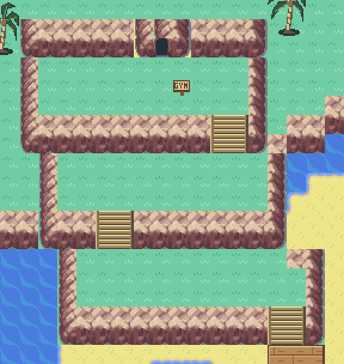

# Corvala cave cove — current design

The November 6 restart replaces the previous 80x64 road-linked town with a
64x64 sheltered reef cove. This is the current authoring design; older
composition-study documents describe superseded experiments.

## Requested layout

- One physical entrance: **Coastal Road → Entrance Cave → Corvala**.
- No east/west town connections, lighthouse, or departure pier.
- A tidal-cave gym above three stair-connected northwest cliff terraces.
- A native red Pokémon Center and blue Poké Mart on raised platforms.
- Five timber houses, with functioning interiors and residents.
- Connected wooden platforms, a sheltered lagoon, and exposed LOW reef shelves.
- Solid support rows beneath dock fronts, with designated stairs to the sand.

The gym has an enterable cave arena and attendant. Its battle, badge, puzzle
and tide gates are not implemented in this map pass. The Mart has a working
clerk and an eight-item stock list; the Center keeps the existing nurse.

The old west/east Corvala road seams were removed on both sides. Coastal Road
now reaches the entrance cave; Harbor Road's former western opening is capped.
The remaining road connections to Eldervale and Havora are retained. Existing
Fly/heal access is relocated to the new Center; the cave is the only ordinary
overworld route into town.

## Cliff and building art revision

The gym ascent uses three cliff terraces with switchback stone stairs. Each
front face blocks walking except at the stairs; host checks reject a bypass
around any tier. Its cave retains the main pool and two smaller tide basins.

The Center now uses the complete native five-by-five Pewter exterior, including
the missing top roof cap and right wall. Transparent grass backing is replaced
with timber while retaining all building pixels and the native animated door.
Dock supports use thicker upright wood piles with grain, fastening bands and
waterline variants. All five house facades have simpler framing, deeper eaves,
recessed doors, and blue window glass independent of roof color.

## Current assets and editing

The redesigned tileset is repacked: **227/384 graphics, 222/384 metatiles**.
Unlike the previous append-only experiments, old experimental metatile IDs do
not apply to this design. Use the current `METATILE_Corvala_*` labels.

Continue editing `Corvala_Town` in Porymap. The installed map and
`tools/corvala/tide_states/low.bin` describe LOW only. MID/HIGH and automatic
tides are not added. Permanent dock cells are recorded in `map.json` so later
tide work can retain access to the services.

- `build_cove.py --write` explicitly regenerates this design. It checks the
  previous output hash and refuses to overwrite unincorporated Porymap edits.
- `connect_cove.py --write` installs the cave/interior wiring. Backport any
  manual interior/event edits before running it again.
- `validate_map.py` validates the current cove. The old procedural generator
  remains locked and is not part of a normal ROM build.
- `tests/corvala_cove_emulator.py` exercises real movement and transitions.

## Preservation and scope

The previous map, art, authoring scripts and related files were backed up to
`corvala-reference/pre-restart-20261106.zip` in the surrounding workspace.
Its old generated artwork and one-time migrations are archived outside the
active repository. Existing map/layout IDs are preserved: new interiors are
appended to the Corvala group and new cave layouts to the layout table.

The current work is local on `feature/corvala-cave-cove-20261106`; it has not
been committed, pushed or merged into V2.

## Verification

The final incremental ROM build passes. EWRAM remains 258,104 bytes and IWRAM
27,573 bytes; the existing RWX linker warnings remain. Host checks validate the
packed preview, tile/palette limits, blocked outer boundary, removed seams,
reciprocal warps, accessible landmarks and relocated heal/Fly landing.

`emulator-corvala-terraces-final-20261107` passes in mGBA: real walking from
Coastal Road through the cave and back, 399 walking steps through the cove,
entry/return for all eight buildings, the Mart Buy menu, three Surf round trips,
the compiled Fly landing and all eight shoreline animation phases. The full
64x64 runtime map is compared with the installed binary. These use fresh-game
fixtures, not a full campaign progression run.

After replacing repeated cave water-edge tiles with continuous native water,
`emulator-corvala-pools-final-20261107` also passes on the final ROM: both pool
maps match their binaries, the gym is crossed on foot and returns correctly
to the upper terrace. Final pool screenshots were inspected.
