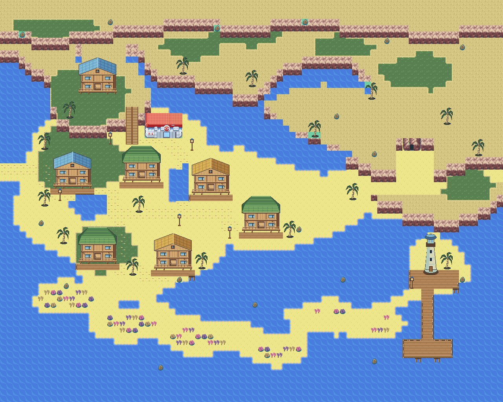

# Corvala LOW implementation — 2026-10-31



The installed map is now 80 × 64 cells. This image uses the actual native
metatile definitions, palettes and map blocks; it is not the earlier mockup.

The western village retains all seven timber houses and the Pokémon Center.
Sandy clearings and shallow pools replace the connected boardwalk. The northern
terraces and eastern headland use exposed rock, grass caps, scattered boulders
and sparse palms. The cave is the native `0xA1`/`0xA9` doorway recessed into
the eastern cliff, with the standard native rock frame around its one-cell
opening. Southern reef shelves lead to the lighthouse island and pier.
The authored deck footprint is 114 cells, down from 712 in the previous implementation.

## Authoring and route connections

Open this repository root in Porymap (FireRed project), then `Corvala_Town`.
Use `gTileset_General` and `gTileset_Corvala`. The redesign has been opened and
visually inspected in Porymap. It was authored through the maintained generator.

`tools/corvala/geography.py` and `build_map.py` are the source of truth. Backport
manual Porymap edits into those files before regenerating: the generator rewrites
the map, tileset, layout dimensions, Center event and reciprocal route headers.
The old geography is replaced, so normal regeneration retains the new design.
Identical output files retain their bytes and timestamps, avoiding unnecessary
Porymap reload prompts and rebuilds.

The former northern Coastal Road connection is deliberately redirected to the
west. Coastal Road already has an eastern two-cell outlet; its north connection
to Eldervale is unchanged. Both new seams retain elevation 3 walking cells:

| Town seam | Neighbor seam | Town connection offset | Reciprocal offset |
|---|---|---:|---:|
| West, y26–27 | Coastal Road east, y11–12 | 15 | -15 |
| East, y27–28 | Harbor Road west, y11–12 | 16 | -16 |

The Center door moves to (26,21), with its approach and Fly landing at (26,22).
The heal-location JSON and generated header move together. Interior return
warps still target outdoor warp 0. House doors are accessible scenery pending
their interiors. The cave approach is walkable; the doorway remains blocked
until a real cave interior/warp exists.

## Engine constraints and verification

The kit uses 287/384 secondary 8px graphics and 323/384 secondary metatiles.
The padded map uses 7,410 of the engine's 10,240 virtual map cells. Palette
channels remain GBA-representable. House and palm transparency uses real tile
layers over the underlying ground. Native General surf graphics 464–481 and
the original animation callback remain live.

Ocean has elevation 1 and collision 0, while land/piers use elevation 3. This
preserves native Surf eligibility and prevents walking into deep water through
the engine's elevation check. Shallow pools use the native shallow-water
behavior at walking elevation. Coral, rocks, trunks and buildings block movement.

Run from the repository root:

```sh
python tools/corvala/build_map.py
python tools/corvala/validate_map.py
python tools/corvala/render_animation.py
```

Validation independently decodes packed metatiles, compares the exact preview,
checks map/asset budgets, recomputes walking routes to every landmark and house,
checks both reciprocal seams and the onward routes, verifies the Center return
warp, and checks Surf water flags/elevations. The animation exporter verifies
eight distinct native surf frames. Its GIF is asset-derived.

`tests/corvala_low_emulator.py` is the targeted gameplay check. Configure
`MGBA_CORE` and `ARM_NM` for a libretro core and matching ARM toolchain. It
compares the loaded map in emulated RAM with LOW, walks between services and
landmarks using directional input, crosses both seams in both directions, enters
and leaves the Center, tests native Surf launch/landing, and samples real surf
animation VRAM.

The Windows devkitARM build completed with GCC 13.2.0. The final cave-frame
adjustment was assembled and linked incrementally with the same tools and
verified full-build objects. The 32 MiB ROM has SHA-256:

`624fd0db5d248ca1acf8a42a1adf86328d9b3130499823a8997d922bcc86531e`

Packed-map validation, byte- and timestamp-identical regeneration, eight-frame
asset animation, and Porymap visual review pass. The mGBA check covers 355 real
walking steps, both route crossings and returns, Center entry/return, the compiled
Fly landing, three native Surf launch/landing round trips, and eight distinct
surf animation phases read from emulated VRAM. Screenshots and a gameplay GIF
are saved under `build/corvala/emulator/`.

## Remaining scope

`tide_states/low.bin` is identical to the installed map. Earlier 56 × 60 states
are preserved unchanged under `tide_states/legacy_56x60/`. Revised MID/HIGH are
deferred until this LOW composition is reviewed. Runtime tides, safe flooding,
Dive/Snorkel, cave Gym/interior, most house interiors, population and encounters
remain separate feature work. No integration-branch merge is part of this pass.
Gameplay checks use a fresh test game. Migration of a save whose player was
standing inside the previous Corvala geography has not been tested; enter the
review map from an adjoining route when using an existing development save.
