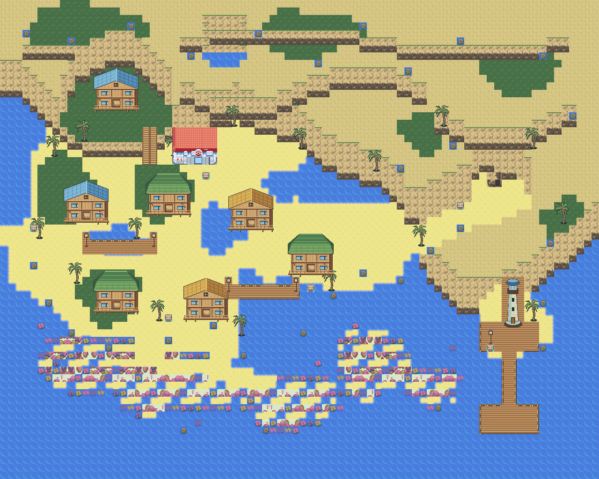

# Corvala low-tide layout target

This 1280 × 1024 image (80 × 64 cells at 16 pixels) records the revised visual layout. It is a design mockup, not a render of the current playable map.

## Layout requirements

- Enter from the west and explore a compact western village before approaching the eastern tidal cave.
- Retain the existing Nordic timber houses, steep roofs, and raised foundations.
- Use short bridges and individual landings; leave sand and shallow water between buildings instead of a continuous wooden plaza.
- Make layered northern and eastern cliffs the main landmark. Favor exposed rock, small grass patches, sand, scattered rocks, and sparse palm trees over woodland.
- Use a normal cave doorway tile rather than an oversized entrance. The future Gym belongs inside the cave system.
- Shape the southern shoreline around irregular tidal pools, exposed sandbars, and organic coral reefs.
- Keep the eastern lighthouse on a small rocky island with a modest pier.

## Implementation status

The image is the next layout target. This commit does not alter map binaries, dimensions, collisions, warps, tilesets, or tide states. The current game map still loads its existing low-tide layout. Runtime tide changes, safe transitions, Dive access, and the Gym interior remain unfinished.

Translate this layout into engine-compatible tiles and walkable terrain before deriving mid- and high-tide maps. The mockup does not establish runtime collision or animation correctness; those require implementation checks and in-game verification.
