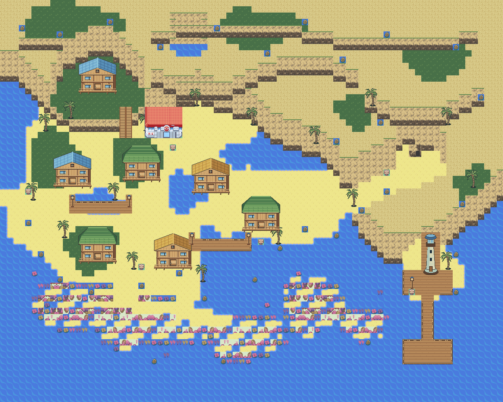

# Corvala low-tide layout target

This 1280 × 1024 image (80 × 64 cells at 16 pixels) records the revised visual layout. It is a design mockup, not a render of the current playable map.

## Layout requirements

- Enter from the west and explore a compact western village before approaching the eastern tidal cave.
- Retain the existing Nordic timber houses, steep roofs, and raised foundations.
- Use short bridges and individual landings; leave sand and shallow water between buildings instead of a continuous wooden plaza.
- Make layered northern and eastern cliffs the main landmark. Favor exposed rock, small grass patches, sand, scattered rocks, and sparse palm trees over woodland.
- Use a normal cave doorway tile rather than an oversized entrance. The future Gym belongs inside the cave system.
- Shape the southern shoreline around irregular tidal pools, exposed sandbars, and organic coral reefs.
- Keep the eastern lighthouse on a small rocky island with a modest pier.

## Implementation status

The reference above remains a design mockup. The playable LOW map has now been
rebuilt at 80 × 64 cells in `geography.py` and `build_map.py`, with the existing
Nordic house pixels, native animated surf and a compact native cave frame.
See [low-tide-implementation.md](low-tide-implementation.md) for the installed
map preview, authoring workflow, route changes and verification limits.

MID/HIGH redesign, runtime tide changes, safe transitions, Dive access, house
interiors and the cave Gym remain unfinished. Earlier 56 × 60 tide experiments
are preserved under `tools/corvala/tide_states/legacy_56x60/`.
