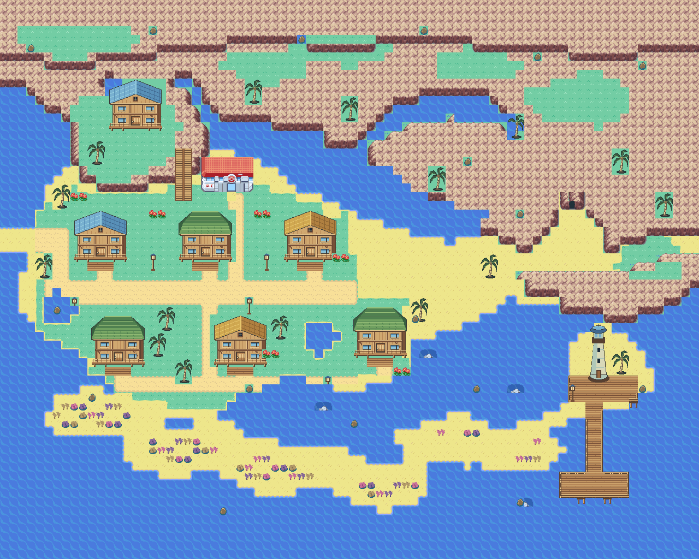

# Corvala: native GBA and authored map comparison

This follow-up starts from `Corvala-dev` commit `78cf8a89`. It was developed
on `feature/corvala-map-composition-20261105` and published to `Corvala-dev`
after review. Further visual cleanup will be authored manually by Cody.

Open `Corvala_Town` in Porymap. Normal ROM builds do not regenerate this map.
The explicit `tools/corvala/build_map.py` tool overwrites its generated map and
tileset: preserve/backport subsequent manual edits before running it again.

## Maps actually inspected

The comparison renders the repositories' real map binaries, metatiles and
palettes, including the authored Havora maps from the current Havora checkout.
It does not use AI concept pictures as evidence of the game's appearance.

| Map | Applied lesson |
| --- | --- |
| One Island | Complete rock caps, side walls and lower corners; grass courtyards enclosed by cliffs; clear stairs |
| Two Island | A distinct public service area; a readable path through a coast bounded by rock |
| Three Island | Homes grouped around a main path with short spurs and planted margins |
| Cinnabar Island | Simple service access and a compact coastal town footprint |
| Havora Market | Consistent frontage spacing, clear circulation and small planted borders |
| Havora West Quadrant | Separate neighborhood terraces and a readable descent toward the waterfront |
| Havora North Quadrant | Distinct public spaces connected by a common path language |
| Havora Coastal Cliffs | Proper cliff corners where the coast changes direction |

Native references come from `data/maps/{OneIsland,TwoIsland,ThreeIsland,
CinnabarIsland}` and the shared General terrain kit. Havora references are
`Havora_Market`, `Havora_WestQuadrant`, `Havora_NorthQuadrant` and
`Havora_CoastalCliffs`. Their source maps and artwork are not modified.

## Corvala changes

The old layout spread homes across disconnected-looking sand/grass patches,
and drew the north/east cliffs mainly as horizontal strips. Native cap, side
and foot silhouettes now follow the complete rock outlines. The cliff overlays
retain FireRed's actual rock pixels and colors, while replacing the native
grass background with the appropriate coastal sand or animated sea.

The existing timber house designs remain intact. Their placements now form
an upper street and lower neighborhood, with a direct Center path, short
porches and a connected main promenade. Native FireRed grass and worn-path
edge geometry supply a consistent terrain style. Corvala's warm sand colors
keep the roads visually distinct from the coastal turf. Flowers and palms
frame spaces rather than filling the paths. The southeast cottage now has a
continuous natural peninsula, not an isolated building footprint.

The cave keeps its small native doorway and has a shaped approach within the
headland. The tidal reef walk, lighthouse and pier remain separate coastal
landmarks; native sea rocks add detail without blocking their land route.
The Center door, Fly landing, map dimensions and reciprocal road seams stay
at their established coordinates. House interiors are not introduced.

## Assets and verification

Exact 8px patterns reuse the primary graphics where possible. Unplaced
intermediate foreground definitions are removed before packing the secondary
metatiles; placed map cells and authoring-kit references are remapped together.
The final kit uses 307/384 graphics and 229/384 metatiles, versus 309 and 370
at the previous commit. No shared primary tileset or runtime code changes.

Packed asset validation and exact preview comparison, seven house approaches,
landmark access, reciprocal road connections, Surf elevations, deterministic
regeneration and all eight asset-derived shoreline frames pass. The incremental
native ARM release build passes; it is not a clean build. EWRAM and IWRAM usage
are unchanged from this branch's existing build.

The targeted mGBA regression checks the complete installed 80×64 map, real
walking to all houses and landmarks, both road crossings/returns, Center
entry/return, compiled Fly landing, native Surf launch/landing and animation
VRAM. These use a fresh test fixture, not an uninterrupted story playthrough.
Runtime tides, the cave Gym and MID/HIGH layouts remain separate work.
