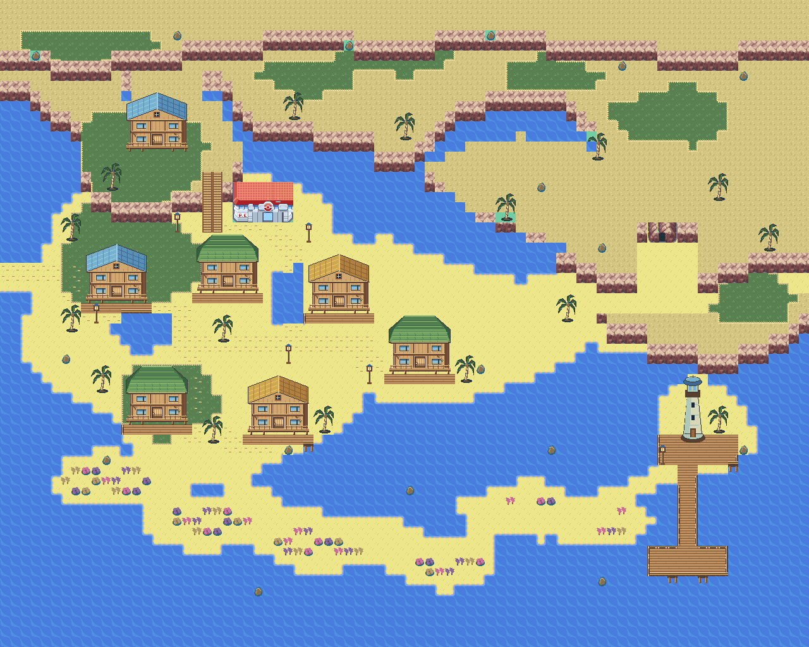

# Corvala town cleanup — 2026-11-04

This pass builds on the existing local 80×64 LOW implementation, preserving
the timber house designs, route seams, Center doorway, cave location and
natural beach/reef layout. The previous uncommitted implementation was backed
up before editing. Developed on `feature/corvala-town-polish-20261104` and
published to `Corvala-dev` after review. No V2 merge is included.

## Visual changes

- Native FireRed cliff faces match the existing native cave frame.
- Smaller turf patches and softer grass edges break up the exposed headland.
- Sparse worn-stone marks and lanterns guide the village paths and services.
- Six short house landings replace the detached wooden rectangles.
- Coral forms distinct reef gardens, leaving clearer sand between clusters.
- The lighthouse has a broader stone body and transparent surroundings over
  real terrain/water, rather than a wooden background filling its full height.
- The Center uses its original four-row roof/facade, removing a duplicated roof
  row while keeping the door and Fly landing at their existing positions.

The map generator now packs only the house composites actually placed on the
map. Preview compositing also respects the GBA's two terrain layers: a new
foreground object replaces prior foreground details, and keeps the ground
layer below it. The independently decoded packed-asset preview matches exactly.

## Verification and limits

The final kit uses 309/384 8px graphics and 370/384 metatiles. EWRAM and IWRAM
usage are unchanged from this Corvala checkout's existing build. The incremental
ARM release build rebuilt map and tileset objects and relinked the ROM; it was
not a clean build. Previous ROM, ELF, map and affected objects are preserved.

`build_map.py`, `validate_map.py`, `render_animation.py` and the deterministic
regeneration check pass. They verify packed pixels, GBA palettes, tile budgets,
all seven house approaches, landmarks, reciprocal route seams, the Center
door/return, Surf-compatible elevations and eight shoreline animation frames.

`tests/corvala_low_emulator.py` passes on the final ROM: 355 real walking steps,
both route crossings and returns, Center entry/return, compiled Fly landing,
three actual Surf launch/landing round trips and eight distinct animation
phases read from emulated VRAM. It uses a fresh-game fixture, not a continuous
story playthrough. Current screenshots are under `build/corvala/emulator/`.

This is LOW-tide town artwork. MID/HIGH redesign, runtime tide changes, safe
flooding, Dive/Snorkel, the cave Gym, house interiors and population remain
separate features. Do not describe the concept sheet's tide cycle as working.
