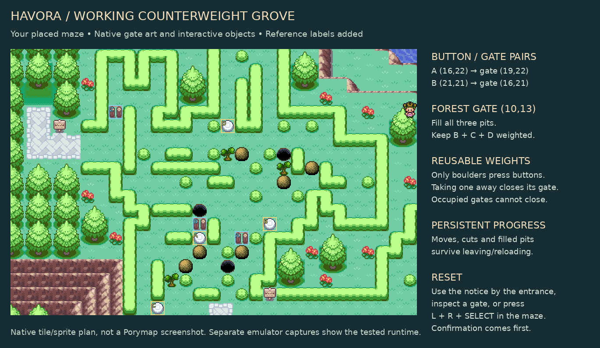
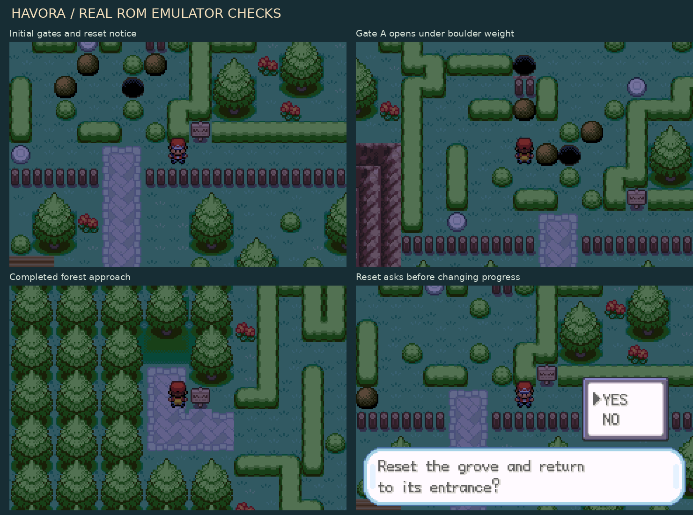

# Havora Counterweight Grove

The user's maze in `HavoraNorthQuadrant` is playable. It uses the existing
six boulders, three Cut trees, three pits and four buttons at their painted
coordinates. There are 16 changed map cells: nine static pieces become grass
under real object events, three pits acquire collision, three gates are
placed, and one blocked hedge cell becomes an entrance notice.

## Wiring

Coordinates are Porymap map coordinates, starting at zero.

| Control | Coordinate | Effect |
| --- | --- | --- |
| Plate A | (16,22) | Holds gate A at (19,22) open |
| Plate B | (21,21) | Holds gate B at (16,21) open; also required for forest gate |
| Plate C | (13,27) | Required for forest gate |
| Plate D | (18,14) | Required for forest gate |
| Pit 1 | (18,24) | Consumes one boulder and becomes walkable |
| Pit 2 | (22,16) | Consumes one boulder and becomes walkable |
| Pit 3 | (16,20) | Consumes one boulder and becomes walkable |
| Forest gate | (10,13) | Opens with all pits filled and B/C/D weighted |

Only boulders provide weight. Plates visually press and release immediately
after a push, and unweighted gates close again. A push that would close a
gate on the player, another boulder, a follower or an NPC is rejected.

`0x231` is the closed timber barrier; `0x232` is the open grass entry. These
reuse existing FireRed fence and grass graphics, taking **zero new 8×8 slots**.
The closed barrier uses collision 1. The open entry is walkable at elevation 6.
The forest approach remains an outdoor walk; no forest destination map/warp
was invented, and existing connections, offsets and warps are preserved.

The entrance notice and gate inspections offer reset with confirmation.
**L + R + SELECT** also opens the reset prompt from inside the maze, so a
boulder deadlock cannot force a save reload. Confirming restores every piece,
uncuts trees, empties pits, releases buttons, closes gates and returns the
player to (20,27). Cancelling changes nothing.

## Persistence and authoring

Boulder coordinates, removed trees and filled pits are stored in the seven
reserved save variables `0x40D0`–`0x40D6`. Map load and resume restore the
object templates and tiles from that state. Offscreen boulders continue
holding their plates. Normal exits do not reset the grove.

The puzzle uses the normal Cut/Strength scripts and field-move prerequisites.
Only the six named grove boulders can enter these custom pits. Other maps'
boulders, holes and switches retain their existing behavior.

`src/havora_puzzle.c` contains the control/coordinate tables;
`tools/havora/counterweight-puzzle.json` records the placed layout, original
cells, named object IDs and verified solution. If moving puzzle components in
Porymap, update the controller tables and that specification together. Keep
the six named boulders consecutive and the three named trees consecutive.
Generated local-ID names allow whole blocks to move within the object list.

The existing ten NPC templates remain intact; the map has 19 templates in
its 64-template budget. The native engine still limits active objects to 16
and loads them by camera range. The full test route successfully loads and
moves every puzzle boulder.

## Verification

- Full ROM compilation succeeded using ARM GCC and `KEEP_TEMPS=1`.
- `python tools/havora/check_counterweight.py` checks the exact 16-cell patch,
  existing NPCs, warps, connections, other districts, unchanged graphics, and
  independently replays the 37-action solution (34 pushes, three cuts).
- `python tools/havora/check_puzzle_tiles.py --rom` checks preservation of the
  original tile art and the linked metatiles, graphics and palettes. Use
  `--migration-snapshot` only to audit the original art-only migration's
  historical no-map-change condition.
- `python tests/havora_counterweight_emulator.py` completes the route using
  native overworld boulder pushes. It verifies pit consumption/collision,
  pressing/releasing plates, gate collision, the forest approach, moved-object
  and Cut-state persistence across a map reload, occupied-gate protection,
  reset cancellation, and confirmed full reset.
- The emulator fixture enables the normal Strength flag and executes native
  `removeobject` commands for Cut results. It does not test the party/badge
  prerequisites or the full Cut field-effect sequence. Actual flash-save /
  restart testing was not performed; progress uses the normal saved variables.
- No Porymap UI walkthrough was performed. Preview art is a native tile/sprite
  render with reference labels. Emulator captures are actual ROM frames.

