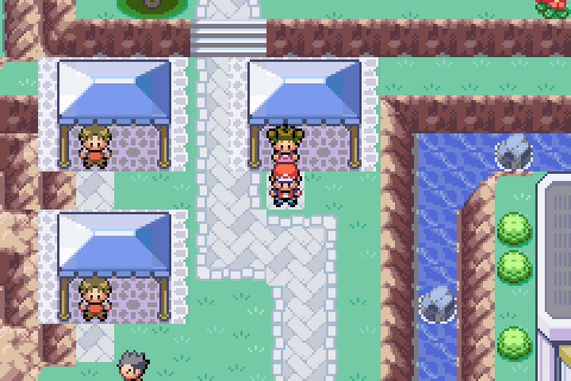
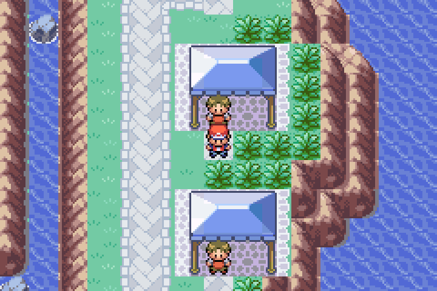
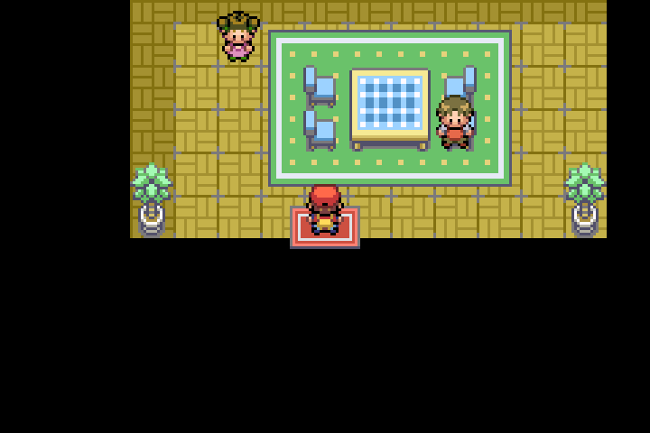

# Havora house transitions and Slateport market stalls

Based on the current combined baseline, V2 `9613f5ce`, including QOL
`ed6e8524` and Randomizer `85cc0784`. New Havora work belongs on
`Havora-Development`; this change is separate from the V2 Randomizer merge.

## House repairs

Weaver House, Fisher House and Cliff House 3 referenced `LAYOUT_HOUSE3`.
`House3_Layout` is retired: mapjson deliberately aliases its ROM layout to
Pallet Town. Entering Weaver House therefore loaded Pallet Town scenery under
an indoor map header, with the player at (4,7) and an unusable return warp.
This reproduced in mGBA before the fix.

All three now use active `LAYOUT_HOUSE2`, with the matching south-arrow exit
at (4,7). Redundant identical warp events were removed. Their existing map IDs,
exterior entrances, return destinations, dialogue and NPCs remain intact.
No retired area is re-enabled and no global retirement behavior changes.

## Market stalls

Eight existing merchants occupy complete four-by-three Slateport canopy stalls
from the already packed shared tileset. The vendors stand in the open front
row, facing customers, so their heads are visible below the canopy. The canopy
and posts block movement; the interior and customer approaches are passable.
These are direct NPC interactions, not invisible counter behavior.

The stalls occupy the western and eastern side streets beside the department
store. The small western blue kiosk is replaced by the matching stall row.
Some eastern tall grass is used for the eastern stalls. Main paths, stairs,
water, buildings and doors remain in place. Existing shop stocks, Meteorite
purchase logic, sold-out dialogue and Koga's position/quest remain unchanged.
No graphics, palettes, shared metatile attributes or EWRAM allocation changes.

`tools/havora/place_market_stalls.py` checks the authored placement.
`--apply` is an explicit one-time migration with a baseline SHA-256 guard;
normal builds never run it or overwrite subsequent Porymap changes.

## Verification

- Incremental native ARM release build: PASS. Map headers/events regenerated;
  map data and tilesets recompiled and ROM relinked. This was not a clean build.
- EWRAM: 238,828 bytes; IWRAM: 27,573 bytes, unchanged. Existing ELF RWX
  segment warnings remain.
- `tests/havora_house_market_emulator.py`: all 11 currently connected Havora
  houses, 14 actual entry/exit round trips, all eight vendor interactions,
  six actual shop menus, Meteorite/sold-out prompts, land access from harbor
  stairs and Koga's four approach tiles: PASS.
- `tests/havora_koga_emulator.py`: final release ROM; ticket/ferry progression,
  actual walk to the market, Koga interaction from four sides, return to gym,
  save/Continue, old-save flags and Giovanni reward regression: PASS.
- Before-fix Weaver House emulator probe: reproduced failed return and
  Pallet Town scenery. It is retained as a failing baseline, not a passing test.

The targeted emulator tests use fixtures to reach maps/story states. They are
not a continuous campaign playthrough. Unconnected legacy house templates are
not newly connected or claimed to have been repaired. Department-store travel
and unrelated map authoring are outside this change.

Actual mGBA captures:

