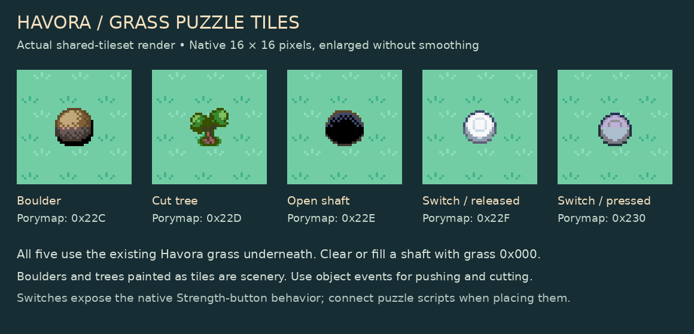

# Havora grass puzzle kit

Available in every map using **gTileset_HavoraCityPrimary + gTileset_HavoraCity**.
The five consecutive entries use the existing grass from metatile `0x000`.

| Porymap ID | Tile | Behavior |
| --- | --- | --- |
| `0x22C` | Boulder on grass | Normal; static visual |
| `0x22D` | Cut tree on grass | Normal; static visual |
| `0x22E` | Open shaft on grass | Normal; no automatic fall warp |
| `0x22F` | Released switch on grass | Native Strength-button behavior `0x20` |
| `0x230` | Pressed switch on grass | Native Strength-button behavior `0x20` |
| `0x000` | Cleared/filled ground | Existing plain grass |

## Placing working puzzle objects

The boulder and tree metatiles are useful for layout studies and scenery. For
working obstacles, paint plain grass `0x000` with walking collision and add
`OBJ_EVENT_GFX_PUSHABLE_BOULDER` or `OBJ_EVENT_GFX_CUT_TREE` object events.
Do not leave the static boulder/tree underneath an interactive object, or the
painted copy will remain after it moves or is cut. The engine object sprites
keep their normal sprite palettes; the static tile art uses Havora's existing
background palettes.

Place switches with walking collision and the same elevation as their
approach. Native Strength-button behavior can run a coordinate-event script
when a boulder lands on that square. Scripts must supply the gate logic,
pressed/released tile updates, and reset behavior; painting these tiles alone
does not implement the Counterweight Grove puzzle.

The shaft is intentionally a normal visual tile rather than `MB_FALL_WARP`.
It will not send the player through an unintended warp. For scenery, block
its square with collision. A playable shaft needs custom boulder entry,
consumption, ground replacement and reset handling. Replace a filled shaft
with grass `0x000` when that behavior is implemented.

## Preservation and capacity

No map layout, border, event, warp, palette or animation file was changed.
All 333 placed Havora metatile definitions retain their rendered pixels.
Complete house, service-building, market, forest-entrance, fountain and court
kits remain available. Existing cliffs and animated water are preserved.

The existing background bank has room for 1,024 graphics, not unlimited
graphics despite empty metatile entries. This migration first aliases seven
graphics used only behind opaque foreground pixels. It then installs 16
static graphics, reclaiming additional space from unused catalog fragments.
The ten retired unplaced definitions and overwritten graphics are recorded
in `tools/havora/puzzle-tiles.json`; source catalog references to those old
fragments are removed. No complete named building kit is retired.

Run `python tools/havora/check_puzzle_tiles.py` to check this migration against
its recorded source commit, and `python tools/havora/review_puzzle_tiles.py`
to regenerate the preview. Do not rerun earlier full tileset generators after
manual Porymap edits.

Asset-preservation, fountain-animation and diagonal-border checks passed for
this migration. A ROM build was attempted but stopped while building `gbagfx`
because the environment lacked `png.h`/the libpng development headers. No
successful ROM compilation, emulator test or Porymap walkthrough is claimed.
