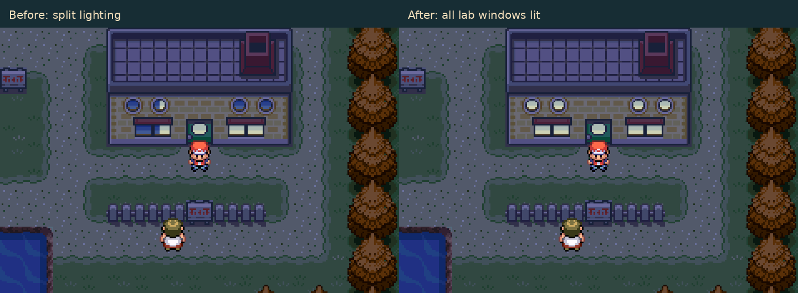
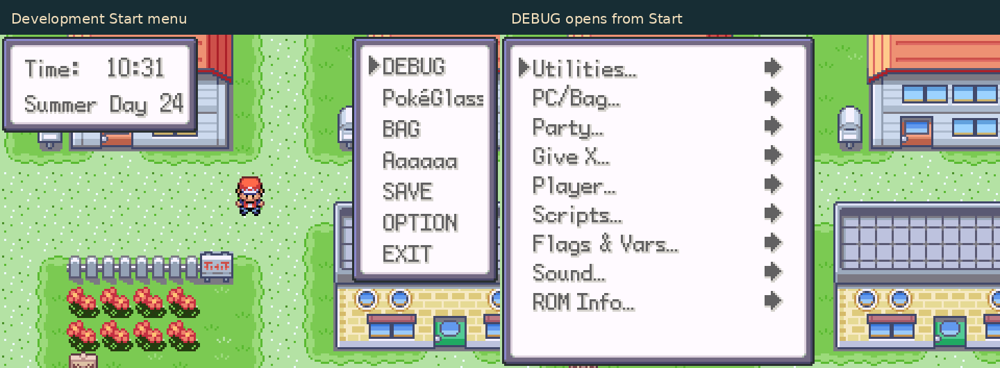

# Shared services and development Start menu

The defects were investigated on Havora-Development after `ddcf9391`.
Read-only comparisons found identical common nurse scripts, message-box code,
Pallet Town metatiles/palettes and debug configuration at:

| Branch | Compared head |
| --- | --- |
| Havora-Development | ddcf9391566167c4fcbfff42ce8de99389b7e19d |
| Pokemon-Quantum-V2 | 5ecfc051c22c4f82f9b6c6b6e3c1d0c0dec12bac |
| Pokemon-Quantum-V1 | 26d5c4a1582d3e3c229f91016bac3c08dcb17589 |
| QOL | 1df9e1212555b1ec3616d53a7bc572875ec94f29 |

These are shared source defects, not Havora-specific map changes. The runtime
reproduction and fixes in this change are on Havora-Development only; the other
three branches were inspected, not modified or run in an emulator.

## Healing

The common nurse script queried `IsPlayerNotInTrainerTowerLobby` and
`BufferUnionRoomPlayerName`, both retired specials whose ROM entries point to
`void NullFieldSpecial`. Their undefined return values can take the script's
bare `end` path, bypassing the goodbye dialogue and caller's `release`.
The emulator reproduced the player walking away while “Okay, I'll take your
POKéMON for a few seconds” remained visible, despite successful healing.

The script now goes directly to the restored-health/goodbye sequence after
healing and quest-log recording. No retired multiplayer service is restored.
The native emulator test covers Havora and Viridian healing, clean dismissal,
and field movement after dismissal.

## Oak's lab

The previous glass isolation changed entire wall metatiles to unlit palette 7,
including portions of the round and rectangular windows. Palette 9 has the
same daytime colors but lights the three blue glass colors. Twenty affected
8×8 quarters per season now use palette 9; bricks, paths and non-glass pieces
retain their unlit palette. No graphics, palette colors or map placements change.

`tests/window_lighting_assets.py --baseline-ref ddcf9391` checks graphics/flips
and identical daytime colors across all 20 tileset variants.
`tests/lab_windows_emulator.py` loads each seasonal Pallet/General pair in the
real ROM, verifies window descriptors and night colors, and checks that the
wall clone remains unlit. Seasonal pairs/time are selected by an emulator-only
fixture; no runtime time/season overrides are included in the build.

## Start menu

Development builds now use `DEBUG_OVERWORLD_IN_MENU = TRUE`: DEBUG appears at
the top of Start, and R+START opens Start normally. The debug setup reuses the
normal menu builder, preserving PokéGlass ownership gating and DexNav entries
when configured. Link/Union Room/Safari menu selection remains unchanged.

`make -j4 DEVELOPMENT=1 KEEP_TEMPS=1` enables the existing development gate.
A normal `DEVELOPMENT=0` build continues to exclude debug access.
`tests/start_debug_menu_emulator.py` checks entry lists before/after receiving
PokéGlass, native debug open/cancel, the former shortcut and restored controls.
Pass `--release` to check the normal build's debug exclusion.

## Actual ROM captures

These are mGBA captures, not Porymap previews.

